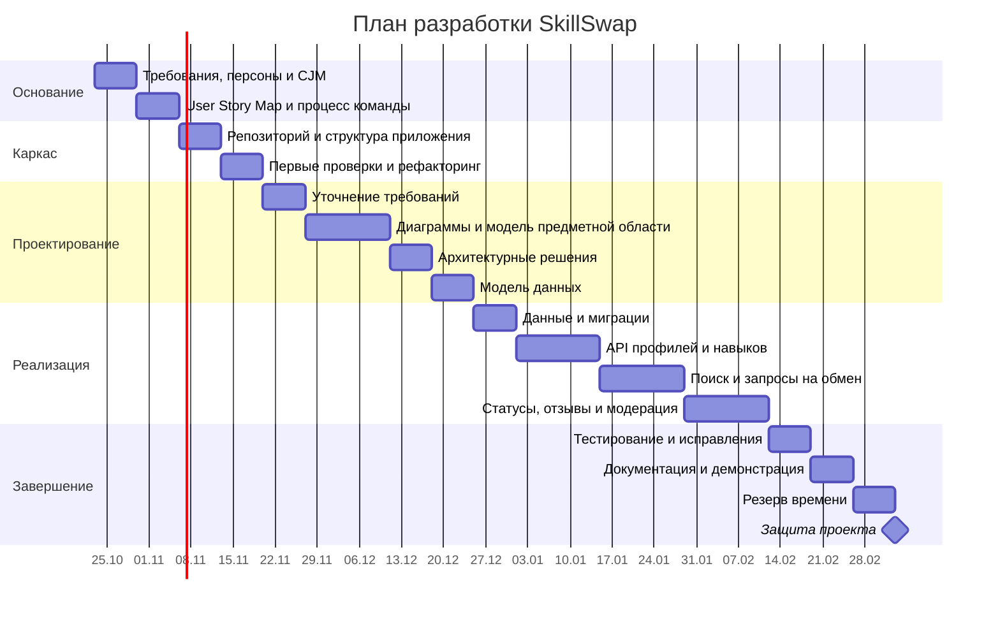

# Диаграмма Ганта — SkillSwap

Даты примерные; их нужно согласовать с календарём курса. Предусмотрен резерв на исправления.

## Контрольные точки

| Точка | Критерий |
|---|---|
| Требования согласованы | Определены роли, проблема, MVP и исключения |
| Каркас готов | Репозиторий и структура приложения доступны команде |
| Модель данных согласована | Определены пользователи, навыки, запросы, отзывы и статусы |
| Сквозной сценарий готов | Можно найти партнёра и обработать предложение |
| MVP проверен | Основные и ошибочные сценарии протестированы |
| Готовность к защите | Документация актуальна, демонстрация повторяема |
