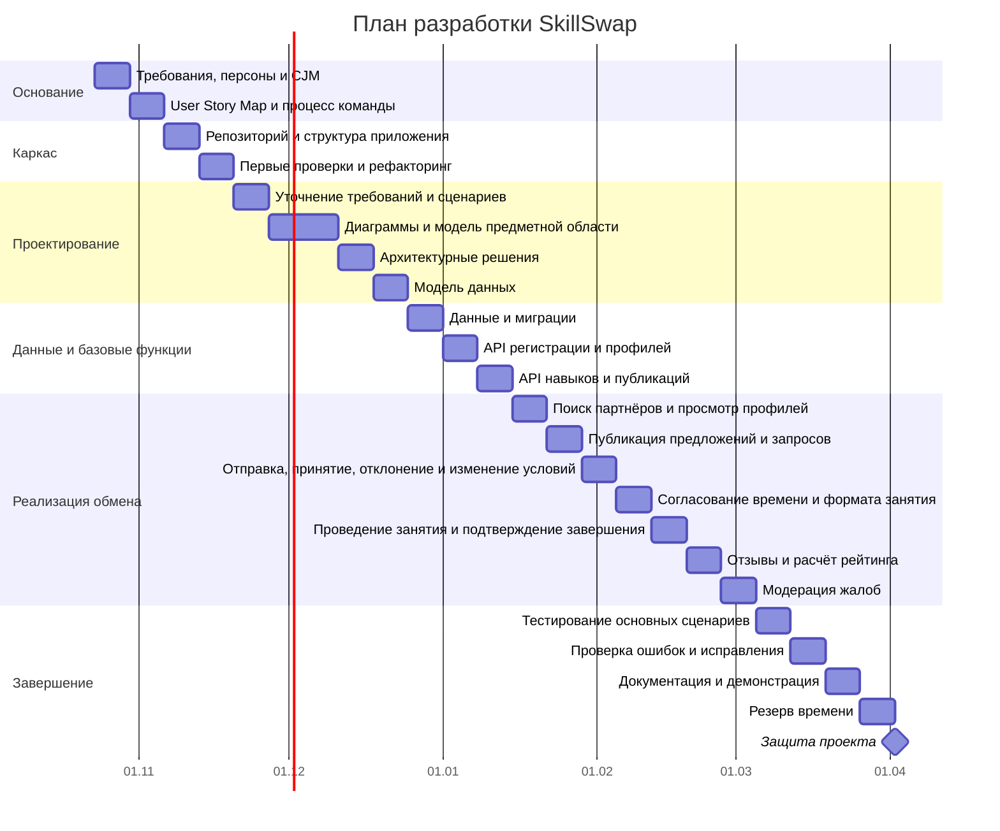

# Диаграмма Ганта — SkillSwap

Даты примерные; их необходимо согласовать с календарём курса. В плане предусмотрен резерв времени на исправления и дополнительные проверки.

## Контрольные точки

| Точка | Критерий |
|---|---|
| Требования согласованы | Определены предметная область, проблема, принципы ролей, два сценария обмена, MVP и ограничения |
| Каркас готов | Репозиторий и структура приложения доступны команде, проект запускается |
| Модель данных согласована | Определены пользователи, навыки, предложения, запросы, обмены, статусы и отзывы |
| Профили и навыки готовы | Пользователь может зарегистрироваться, заполнить профиль и указать навыки |
| Поиск готов | Можно искать участников, предложения и запросы по навыкам |
| Создание обмена готово | Можно опубликовать предложение или запрос, отправить отклик и обработать его |
| Согласование готово | Участники могут принять условия, предложить изменения и зафиксировать время и формат занятия |
| Завершение обмена готово | Проведённое занятие подтверждается обеими сторонами, после чего обмен получает статус «Завершён» |
| Отзывы готовы | Оба участника могут оставить отзыв, рейтинг рассчитывается по последним 50 отзывам |
| MVP проверен | Основные и ошибочные пользовательские сценарии протестированы, базовая модерация работает |
| Готовность к защите | Документация актуальна, демонстрация проекта воспроизводится |

## Примечания к планированию

- Указанные даты являются предварительными и могут изменяться в зависимости от календаря курса.
- Последовательность задач отражает основные зависимости между этапами разработки.
- Перед переходом к следующему крупному этапу необходимо проверить результат предыдущего.
- В первую очередь реализуются функции, необходимые для полного цикла обмена навыками.
- Календарь доступности, встроенный чат, напоминания и рекомендации относятся к последующим версиям и не должны задерживать реализацию MVP.
- Резерв времени используется для исправления ошибок, повторного тестирования и подготовки демонстрации.