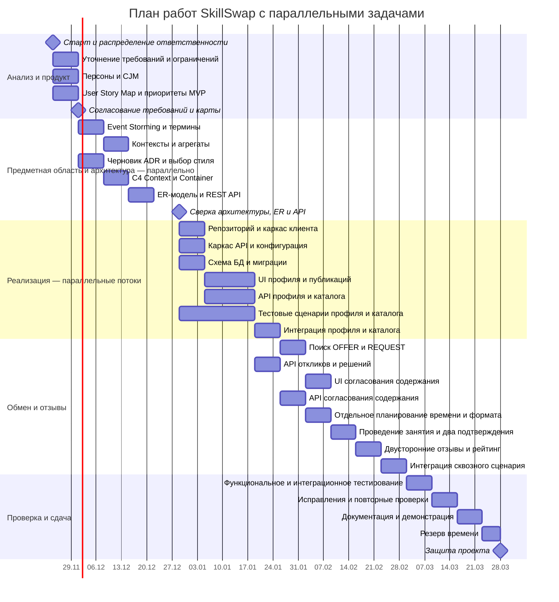

# Диаграмма Ганта — SkillSwap

Даты демонстрационные и должны быть сверены с фактическим календарём курса. Диаграмма показывает не только последовательные зависимости, но и параллельную работу потоков: требования и UX; доменная модель и архитектурные решения; интерфейс, API и тестовые сценарии. Параллельность допустима там, где задачи используют уже согласованные контракты и не блокируют друг друга.

## Где именно выполняются параллельные действия

| Параллельные задачи | Почему можно выполнять одновременно | Условие синхронизации |
|---|---|---|
| Требования, персоны/CJM и User Story Map | Разные представления одной проблемы, уточняются совместно | Перед фиксацией MVP сверить термины и приоритеты |
| Event Storming и подготовка ADR | Доменная модель и сравнение архитектурных вариантов могут идти отдельными потоками после требований | ADR-0003 подтверждается после определения контекстов |
| C4 и ER/API | Архитектурные контейнеры и контракты проектируются параллельно по согласованным границам | Общая проверка связности после завершения обоих потоков |
| Клиент, API и тестовые сценарии | Команды могут работать по согласованным API-контрактам и макетам | Интеграция после готовности интерфейсов и контрактов |
| UI и серверная реализация функций обмена | Фронтенд и backend развиваются независимо по одному сценарию | Контрактные проверки и совместная интеграция |

## Контрольные точки

| Точка | Критерий |
|---|---|
| Требования согласованы | Зафиксированы две независимые публикации OFFER/REQUEST и роли в контексте обмена |
| Проектирование завершено | Event Storming, контексты, агрегаты, ADR, C4, ER и API согласованы между собой |
| Базовые функции готовы | Профиль, навыки, публикации и поиск работают по двум типам публикаций |
| Содержание обмена согласовано | Обе стороны подтвердили содержание/объём обмена |
| Занятие запланировано | Дата, время и формат согласованы отдельно от содержания |
| Обмен проведён | Зафиксирован факт занятия; планирование не считается проведением |
| Обмен завершён | Получены два подтверждения проведения |
| Отзывы готовы | Каждый участник может оставить отзыв о другом после завершения |
| MVP проверен | Пройдены позитивные и негативные сценарии, устранены критические ошибки |
| Готовность к защите | Документация актуальна, демонстрация воспроизводится |

## Примечания

- Параллельные задачи не означают отсутствие зависимостей: перед интеграцией должны быть согласованы интерфейсы и термины.
- Даты условные; их необходимо заменить на даты, согласованные с преподавателем и командой.
- Встроенная видеосвязь, кошелёк, чат, календарная синхронизация и сложные рекомендации не блокируют MVP.
